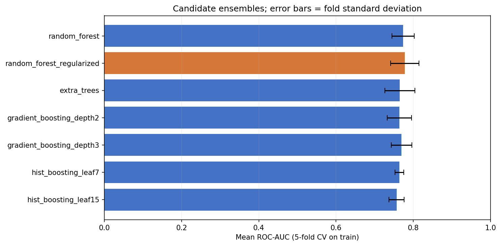
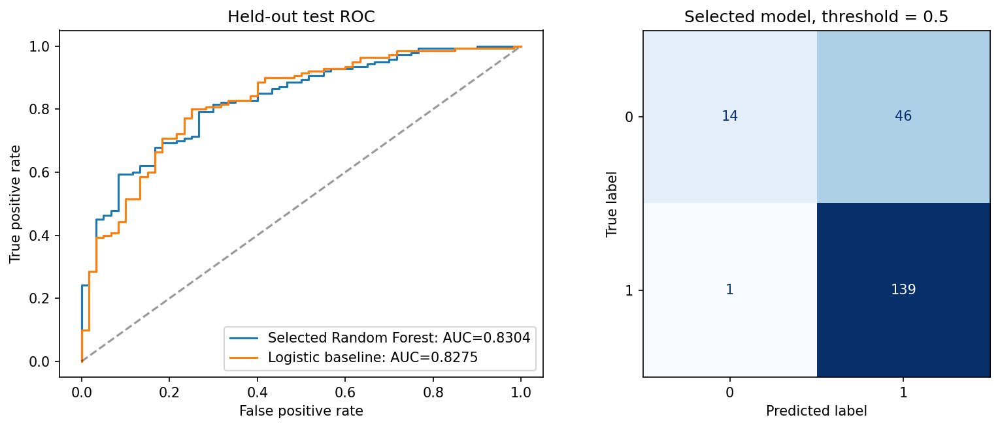

# Лабораторная работа №4. Ансамбли

## Данные и подготовка

Использован german.csv из задания: 1000 строк, 20 признаков, цель — первый столбец Creditability. Метки: 700 единиц и 300 нулей. Пропусков в исходной таблице нет. Положительный класс всех метрик — 1.

Внешний split: train_test_split(test_size=0.2, random_state=42, stratify=y). Обучающая часть содержит 800 строк (560 единиц, 240 нулей); тестовая — 200 строк (140 единиц, 60 нулей). Это же правило разбиения использовалось в предыдущей лабораторной. Индекс и целевой столбец не включаются в признаки.

Количественные признаки: Duration_of_Credit_monthly, Credit_Amount, Instalment_per_cent, Duration_in_Current_address, Age_years, No_of_Credits_at_this_Bank, No_of_dependents. Остальные 13 столбцов рассматриваются как категориальные коды и преобразуются OneHotEncoder(handle_unknown='ignore', sparse_output=False). Число признаков после преобразования на полном train: 61. Новые признаки сверх one-hot не добавлялись, отбор признаков не проводился.

Масштабирование для деревьев не применяется: разбиения основаны на порогах отдельных признаков и не требуют одинаковых единиц измерения. В Pipeline предусмотрено заполнение числовых пропусков медианой и категориальных — наиболее частым значением. Эти статистики и словари категорий обучаются только на train; при CV — заново внутри каждого фолда. Для логистической модели сравнения числовые признаки дополнительно стандартизируются внутри её Pipeline.

## Гипотезы и эксперименты

До итоговой тестовой оценки проверены семь конфигураций. Критерий выбора — максимальный средний ROC-AUC пятичастной StratifiedKFold(n_splits=5, shuffle=True, random_state=42) только на внешней обучающей части. В каждом фолде 640 обучающих и 160 валидационных строк. Все конфигурации используют одинаковые фолды. test_target не участвует в fit, подготовке признаков, CV или выборе порога.

1. **Random Forest:** 300 деревьев, bootstrap=True, max_features='sqrt', без ограничения глубины. Гипотеза: усреднение разных деревьев уменьшит разброс прогноза по сравнению с одиночным деревом.
2. **Random Forest с ограничениями:** те же 300 деревьев, max_depth=6, min_samples_leaf=3. Гипотеза: ограничение сложности улучшит качество на малой выборке и уменьшит подгонку отдельных наблюдений.
3. **Extra Trees:** 300 деревьев, min_samples_leaf=2; bootstrap=False по умолчанию. Гипотеза: случайный выбор порогов даст дополнительное разнообразие деревьев; возможен и рост смещения.
4. **Gradient Boosting, глубина 2:** 150 деревьев, learning_rate=0.05. Гипотеза: последовательное исправление ошибок неглубокими деревьями учтёт нелинейности при ограниченной сложности.
5. **Gradient Boosting, глубина 3:** остальные параметры те же. Проверяется, полезны ли более сложные взаимодействия признаков.
6. **HistGradientBoosting, 7 листьев:** 150 итераций, learning_rate=0.1, max_leaf_nodes=7, l2_regularization=1, early_stopping=False. Проверяется более сильное ограничение сложности бустинга.
7. **HistGradientBoosting, 15 листьев:** прочие настройки те же. Проверяется влияние большей сложности деревьев. Для обоих вариантов min_samples_leaf=20 по умолчанию.

Общие параметры случайности — seed=42; вычисления ограничены одним потоком и n_jobs=1. MLP и другие нейросети в решении не используются: по условию достаточно ансамбля.

## Метрики

В таблице — средние метрики на пяти валидационных фолдах внешнего train. Стандартное отклонение ROC-AUC вычислено с ddof=0; это разброс фолдов, а не доверительный интервал. ROC-AUC считается по вероятностям класса 1, остальные метрики — по классам при пороге 0.5. F1 усредняется по фолдам, а не вычисляется из уже усреднённых Precision и Recall.

| Конфигурация | ROC-AUC | Std AUC | Accuracy | Precision | Recall | F1 |
| --- | ---: | ---: | ---: | ---: | ---: | ---: |
| random_forest | 0.773586 | 0.028894 | 0.760000 | 0.774098 | 0.928571 | 0.843883 |
| random_forest_regularized | 0.778199 | 0.036465 | 0.725000 | 0.730601 | 0.962500 | 0.830443 |
| extra_trees | 0.765179 | 0.039050 | 0.747500 | 0.772453 | 0.907143 | 0.833694 |
| gradient_boosting_depth2 | 0.764025 | 0.031593 | 0.743750 | 0.767312 | 0.910714 | 0.832503 |
| gradient_boosting_depth3 | 0.769680 | 0.026659 | 0.771250 | 0.796127 | 0.905357 | 0.846794 |
| hist_boosting_leaf7 | 0.764211 | 0.011596 | 0.730000 | 0.779012 | 0.858929 | 0.816365 |
| hist_boosting_leaf15 | 0.756808 | 0.019901 | 0.730000 | 0.785918 | 0.844643 | 0.813651 |



После выбора конфигурация зафиксирована в SELECTED_MODEL. Модель обучена на всех 800 обучающих строках и применена к отложенным 200 строкам. Отдельная логистическая модель сравнения обучена на тех же 800 строках: LogisticRegression(C=1.0, max_iter=2000, random_state=42), числовые признаки стандартизированы. Эта модель не входит в кандидаты ансамбля и не влияет на его выбор.

| Оценка | ROC-AUC | Accuracy | Precision | Recall | F1 |
| --- | ---: | ---: | ---: | ---: | ---: |
| Выбранный лес, train | 0.915320 | 0.810000 | 0.788136 | 0.996429 | 0.880126 |
| Выбранный лес, test | 0.830357 | 0.765000 | 0.751351 | 0.992857 | 0.855385 |
| Логистическая модель, test | 0.827500 | 0.800000 | 0.837838 | 0.885714 | 0.861111 |



При отсутствии предсказанных единиц Precision и F1 определяются как 0 (zero_division=0). Если в переданном test только один класс, ROC-AUC не определён и возвращается NaN; в основном эксперименте оба класса есть.

## Выбранная модель

Выбран **Random Forest (300 trees, depth=6, leaf=3)**. Его средний CV ROC-AUC — **0.778199**, максимальный среди семи заранее заданных конфигураций. Test ROC-AUC после выбора — **0.830357**.

Случайный лес обучает деревья на bootstrap-выборках обучающих строк. В каждом узле рассматривается случайное подмножество признаков (max_features='sqrt'), чтобы уменьшать сходство деревьев. Вероятность класса 1 — среднее вероятностей деревьев; внутри листа вероятность основана на долях классов обучающих объектов этого листа. Использованы 300 деревьев, глубина не более 6 и минимум 3 объекта в листе; порог класса 1 — p >= 0.5. Число деревьев ограничивает время CPU, ограничения глубины и размера листа регулируют сложность.

## Выводы и ограничения

Ограничение глубины и минимального размера листа увеличило средний CV ROC-AUC леса с 0.773586 до 0.778199. Extra Trees дал 0.765179. У классического бустинга увеличение глубины с 2 до 3 повысило AUC с 0.764025 до 0.769568, но не превзошло выбранный лес. У гистограммного бустинга увеличение числа листьев с 7 до 15 снизило AUC с 0.764211 до 0.756808. Это наблюдения для данной схемы CV, а не универсальные свойства алгоритмов.

На test лес имеет Δ ROC-AUC = +0.002857, Δ Accuracy = -0.035000, Δ F1 = -0.005726 относительно логистической модели. Высокий Recall леса достигается при большем числе положительных предсказаний, что снижает Precision. Порог 0.5 не подбирался по test. Модель, всегда выбирающая класс 1, имеет test Accuracy=0.7, поэтому одной Accuracy для оценки недостаточно.

Тестовый ROC-AUC выше среднего CV; на небольшой выборке качество зависит от состава разбиения. Разница CV AUC двух лесов мала по сравнению с межфолдовым разбросом. Статистическая значимость различий не проверялась. Отдельная оценка калибровки вероятностей, бизнес-стоимости ошибок и справедливости по подгруппам не проводилась. Выводы ограничены этим учебным набором и фиксированным split.

## Воспроизводимость

Весь код находится в ensemble_models.py. Контрактная функция run_ensemble_experiment использует зафиксированную конфигурацию, не выполняет подбор по test и принимает как DataFrame, так и готовые числовые массивы. Её вероятности, предсказания и метрики соответствуют строке выбранной модели на test. main() повторяет CV, проверяет выбор, обучает финальную модель и формирует отчёт, JSON и графики.

random_seed=42; внешний split 80/20 со стратификацией; внутренние 5 фолдов перемешиваются с тем же seed. Передача иного random_seed в контракт меняет случайность модели, но не зафиксированные параметры.

Версии: Python 3.12.2, NumPy 2.3.5, Pandas 2.2.3, SciPy 1.17.0, scikit-learn 1.8.0, Matplotlib 3.10.8.
Зависимости закреплены в requirements.txt; рекомендуется Python 3.12 (не ниже 3.11). Возможны небольшие платформенные различия арифметики с плавающей точкой.

```bash
python -m pip install -r requirements.txt
python -m unittest discover -s tests -v
python ensemble_models.py
```

На Windows команды можно выполнить через Python окружения: `.\.venv\Scripts\python.exe` вместо `python`; окружение создаётся командой `python -m venv .venv`.

experiment_results.json содержит параметры, средние и пофолдовые CV-метрики, критерий выбора, итоговые train/test-метрики и версии среды. Метрики сохраняются без округления. Исходные README, german.csv и grader_contracts сохранены без изменений. Тесты проверяют формат результата, вероятности, метрики, пропуски, неизвестные категории, воспроизводимость и отсутствие влияния test_target на прогноз. Скрытые тесты преподавателя не предоставлены.
